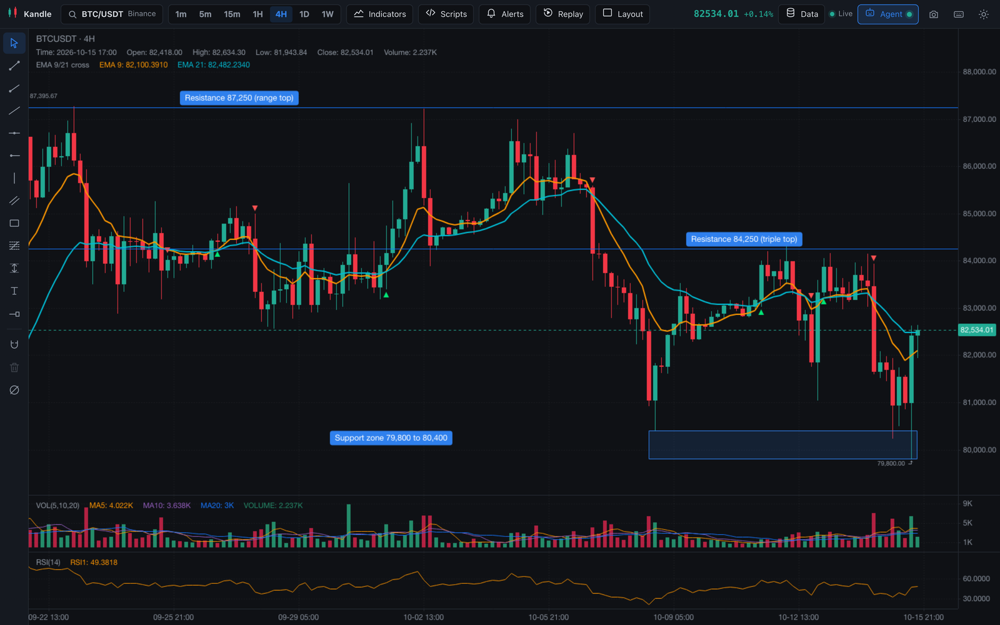
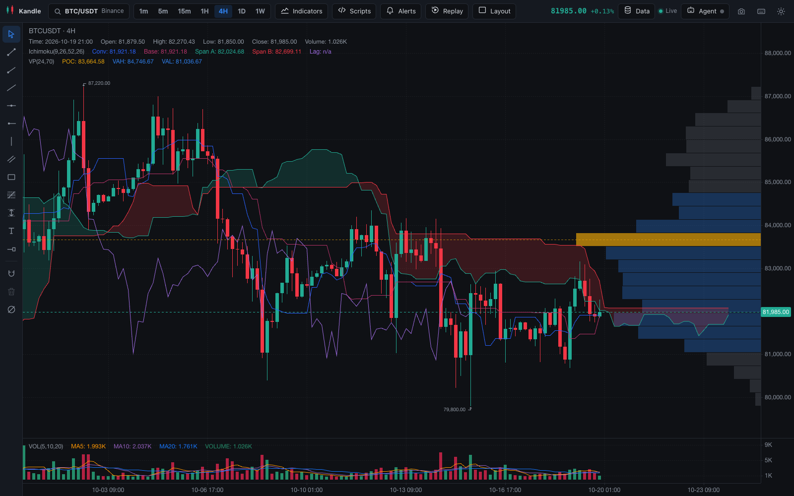
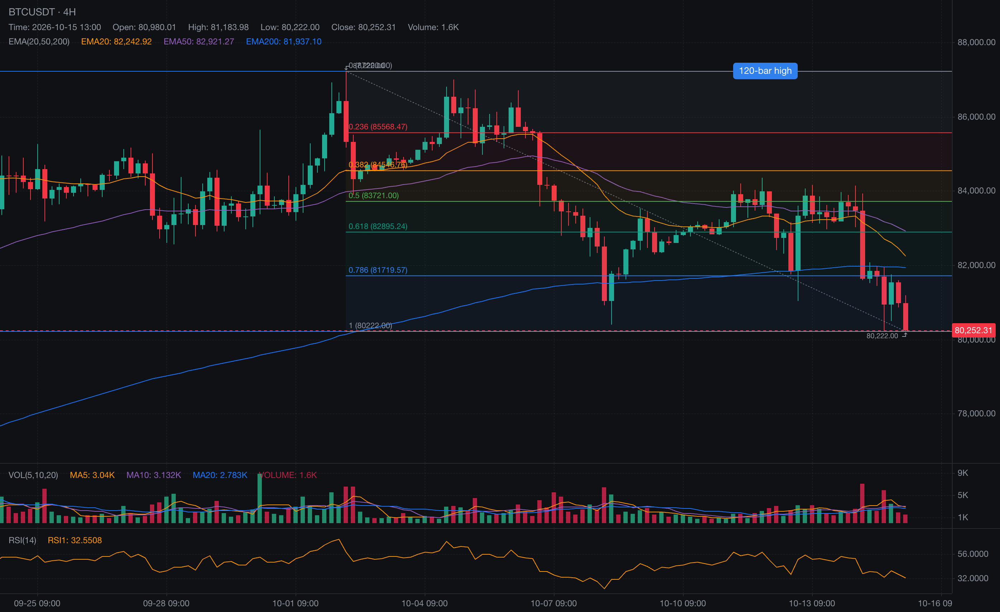
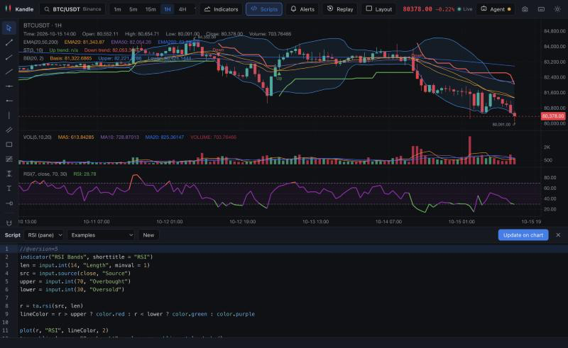
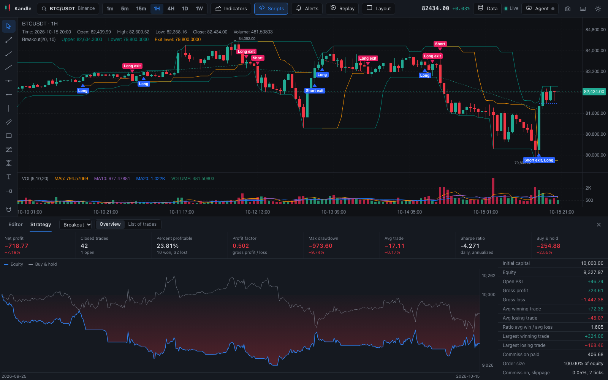
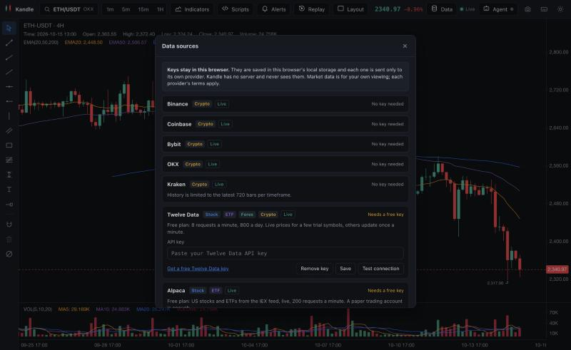
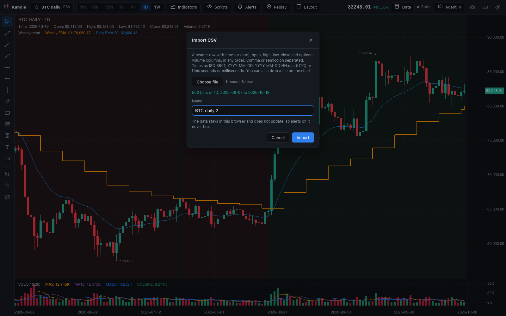

# Kandle

**Free, open-source charts for crypto, stocks and forex, and your AI agent can drive them.**

Indicators, drawing tools, your own scripts and strategy backtests, alerts, bar replay and up to four charts on screen. No account, no paywall, no limit on indicators. It runs in your browser and keeps everything on your machine.

Claude Code, Codex, Cursor or Gemini CLI can read the chart, draw support and resistance, add indicators, write scripts and set alerts while you watch.

**[Open Kandle in your browser](https://kernel-hunter.github.io/kandle/)** · [Connect your agent](#use-it-with-your-ai-agent) · [Write a script](#scripts)

[](https://github.com/Kernel-Hunter/kandle/actions/workflows/ci.yml)
[](LICENSE)

[English](README.md) · [简体中文](README.zh-CN.md)



## Connect your agent in one line

```sh
claude mcp add kandle -- npx -y --package=https://github.com/Kernel-Hunter/kandle/releases/download/v0.4.0/kandle-mcp-0.4.0.tgz kandle-mcp
```

Then open Kandle, click **Agent**, paste the pairing code your agent gives you and turn on **Agent bridge**. Ask it something like "mark the last swing high and low on BTC and draw a Fibonacci retracement between them". Setup for other agents is [below](#use-it-with-your-ai-agent).


## Features

- Live crypto candles from Binance, Coinbase, Bybit, OKX and Kraken public market data, with no key. History loads over REST and updates stream over websockets.
- US and global stocks, ETFs and forex from Twelve Data, Alpaca or Polygon with your own free API key. See [Data sources](#data-sources).
- Your own OHLCV data from a CSV file, kept in your browser. See [CSV import](#csv-import).
- Symbol search for the chosen source, with Crypto, Stock, ETF, Forex, Index and CSV badges.
- Timeframes: 1m, 5m, 15m, 1H, 4H, 1D, 1W. Scroll left to load older history.
- 36 indicators, with as many on the chart as you like: MA, EMA, SMA, WMA, HMA, Bollinger Bands, Donchian Channel, VWAP, Supertrend, Parabolic SAR, Ichimoku Cloud, Volume Profile, Volume, MACD, RSI, Stochastic RSI, KDJ, ATR, OBV, CCI, DMI/ADX, Williams %R, ROC, Momentum, TRIX, Awesome Oscillator and more. Every parameter can be edited.
- Ichimoku Cloud with the cloud drawn ahead of the last candle, and a volume profile of the bars on screen that marks the point of control and the value area. The profile updates as you scroll and zoom.
- Drawing tools: trend line, ray, extended line, horizontal line and ray, vertical line, parallel channel, rectangle, Fibonacci retracement, price range, text notes and price labels. Select a drawing to move it or delete it. An optional magnet snaps points to candle prices.
- Your symbol, timeframe, theme, indicators, and drawings (saved per symbol) come back when you reload.
- Dark and light themes.
- Keyboard shortcuts for most actions. Press `?` in the app to see them all.
- Export the chart as a PNG image.
- Scripts: write your own indicators in Kandle Script, with an editor under the chart and 14 example scripts. Scripts can read other timeframes and other symbols with `request.security`.
- Strategy backtests: write a strategy script, see its trades on the chart, and get net profit, drawdown, win rate, an equity curve and the list of trades.
- Alerts on price levels, drawn lines and indicator values, with browser notifications.
- Bar replay to step through history one candle at a time.
- 1, 2 or 4 charts on screen, each with its own symbol, timeframe and indicators.
- An MCP server so AI agents can read the chart, draw on it, set alerts and take screenshots.
- Works on desktop and tablet screens.



### Keyboard shortcuts

| Keys | Action |
| --- | --- |
| Any letter or digit | Search symbols |
| `/` or `Alt+I` | Indicators |
| `Alt+S` | Script editor |
| `Ctrl+Enter` or `Cmd+Enter` | Add or update the script on the chart (in the editor) |
| `Alt+1` to `Alt+7` | Timeframes 1m to 1W |
| `Alt+T` | Trend line |
| `Alt+R` | Ray |
| `Alt+H` | Horizontal line |
| `Alt+V` | Vertical line |
| `Alt+B` | Rectangle |
| `Alt+F` | Fibonacci retracement |
| `Alt+P` | Price range |
| `Alt+N` | Text note |
| `Alt+M` | Magnet on or off |
| `Delete` | Delete the selected drawing |
| `Esc` | Cancel the current drawing or close a dialog |
| `Alt+L` | Switch between light and dark |

## Use it with your AI agent

Kandle ships an MCP server, `kandle-mcp`. Your agent starts it, and the Kandle tab in your browser connects to it over a WebSocket on `127.0.0.1`. The agent can then read the chart and change it while you watch.

### Set up

1. Add the server to your agent (the snippets are below).
2. Ask the agent for the Kandle pairing code. It calls `get_bridge_status` and shows a code like `K7QD-9MXR-2HPA`. The code is also saved in `~/.kandle/bridge-token`.
3. In Kandle, click **Agent** in the top bar, paste the code, and turn on **Agent bridge**. The dot on the button turns green when the agent is connected.

The code is saved in your browser and in `~/.kandle/bridge-token`, so you only pair once.

This works with the [hosted app](https://kernel-hunter.github.io/kandle/) and with a copy you run yourself. With the hosted app, your browser may ask whether the page can reach devices on your local network; allow it so the page can talk to `kandle-mcp` on `127.0.0.1`.

`npx` runs `kandle-mcp` from a GitHub release, so you only need Node.js 22.12 or newer. When a new version of Kandle comes out, change the version in the URL; `get_bridge_status` tells your agent when the app is newer than its server. To run it from a clone instead, use `pnpm install && pnpm build` and point your agent at `node /path/to/kandle/packages/mcp/bin/kandle-mcp.js`.

Claude Code:

```sh
claude mcp add kandle -- npx -y --package=https://github.com/Kernel-Hunter/kandle/releases/download/v0.4.0/kandle-mcp-0.4.0.tgz kandle-mcp
```

Codex (`~/.codex/config.toml`):

```toml
[mcp_servers.kandle]
command = "npx"
args = ["-y", "--package=https://github.com/Kernel-Hunter/kandle/releases/download/v0.4.0/kandle-mcp-0.4.0.tgz", "kandle-mcp"]
```

Cursor (`~/.cursor/mcp.json` or `.cursor/mcp.json` in a project) and Gemini CLI (`~/.gemini/settings.json`):

```json
{
  "mcpServers": {
    "kandle": {
      "command": "npx",
      "args": ["-y", "--package=https://github.com/Kernel-Hunter/kandle/releases/download/v0.4.0/kandle-mcp-0.4.0.tgz", "kandle-mcp"]
    }
  }
}
```

Claude Desktop: download [kandle-mcp-0.4.0.mcpb](https://github.com/Kernel-Hunter/kandle/releases/download/v0.4.0/kandle-mcp-0.4.0.mcpb) and open it to install the server.

Kandle is also listed in the [MCP Registry](https://registry.modelcontextprotocol.io/) as `io.github.Kernel-Hunter/kandle`, so clients that browse the registry can find it.

### Tools

| Tool | What it does |
| --- | --- |
| `get_bridge_status` | Connection state and the pairing code |
| `get_chart_state` | Symbol, timeframe, last bar, visible range, indicators with latest values, drawings with ids, alerts, replay and layout |
| `set_symbol`, `set_timeframe` | Change the market or bar size. Exchange `csv` opens a dataset you imported |
| `get_candles` | OHLCV bars by count or time range, optionally with indicator values per bar |
| `add_indicator`, `remove_indicator`, `list_indicators` | Manage indicators and list the 36 available |
| `draw` | Trend line, horizontal line or ray, vertical line, ray, extended line, rectangle, Fibonacci retracement, text note, price range, all by price and time |
| `remove_drawing`, `clear_drawings` | Remove drawings |
| `screenshot` | PNG of a chart, returned as an image |
| `set_alert`, `list_alerts`, `remove_alert` | Alerts on price, drawn lines and indicators |
| `start_replay`, `step_replay`, `stop_replay` | Bar replay |
| `set_layout` | 1, 2 or 4 charts, sync options, symbol and timeframe per chart |
| `run_script` | Adds a Kandle script to the main chart and returns its id, input values and latest plot values, or the error with line and column. `inputs` sets input values by title and `id` replaces a script added earlier. For a strategy it also returns the backtest summary and the last 20 trades |
| `get_backtest` | Settings, summary and up to 500 trades of a strategy script on the chart |

Most tools take an optional `pane` (1 to 4) when several charts are showing. Times can be ISO 8601 dates or Unix times in seconds or milliseconds. Inputs are validated and errors say what to fix.

[`skills/kandle/SKILL.md`](skills/kandle/SKILL.md) is an agent skill with chart analysis workflows: support and resistance, trend, indicator confluence, and annotating a chart with an explanation. Copy it into your agent's skills folder (for Claude Code, `~/.claude/skills/kandle/`).



### Security model

- The bridge only listens on `127.0.0.1`. Nothing is reachable from other machines.
- The app connects to the server, not the other way round, and only after you turn on **Agent bridge**. It is off by default and you can turn it off at any time.
- Every connection must send the pairing code first. The code has about 59 bits of randomness, is compared in constant time, and the server stops accepting codes for a minute after 5 wrong ones.
- The server rejects WebSocket connections from web pages that are not served from `localhost`, `127.0.0.1` or `[::1]`, so a website you visit cannot connect even if it guesses the port. The hosted app at `https://kernel-hunter.github.io` is also allowed. Add other origins, such as your own hosted copy, with `KANDLE_ALLOWED_ORIGINS`.
- The server rejects requests whose `Host` header is not a loopback address, which blocks DNS rebinding.
- The agent can only do what the tools allow: read chart data, change symbols, indicators, drawings, alerts, replay and layout, and take screenshots of the chart. It cannot read other tabs, your files or your browser storage.
- Only one Kandle tab is connected at a time. A newer tab takes over and the older one shows that it was replaced.
- Programs running as your user on the same computer can read `~/.kandle/bridge-token`. That is the same trust level as the agent itself.

Settings: `--port` or `KANDLE_PORT` (default 7457, change the port in the Agent dialog to match), `KANDLE_TOKEN` for a fixed code, `KANDLE_HOME` for the token folder.

## Scripts

Kandle Script lets you write your own indicators and backtest strategies. It is compatible with the scripting language most chart users already know, so many existing indicator scripts run with few or no changes.

Click **Scripts** (or press `Alt+S`) to open the editor under the chart. Write a script, or pick one from **Examples**, and press `Ctrl+Enter` (`Cmd+Enter` on a Mac) to add it to the chart. Errors are underlined as you type, with the line, column and message below the editor. Pick a script from the list at the top left of the editor to change it later.

```
//@version=5
indicator("EMA cross", overlay = true)
fastLen = input.int(9, "Fast", minval = 1)
slowLen = input.int(21, "Slow", minval = 1)

fast = ta.ema(close, fastLen)
slow = ta.ema(close, slowLen)

plot(fast, "Fast", color.orange, 2)
plot(slow, "Slow", color.blue, 2)
plotshape(ta.crossover(fast, slow), "Up", shape.triangleup, location.belowbar, color.green)
```

Scripts with `overlay = true` draw on the price chart; the others get their own pane. Inputs show up in the **Indicators** dialog, where you can change them without touching the code. Scripts and their input values are saved with your layout. When a new candle arrives or the last one changes, only the last bar is calculated again; a full run over 1,500 bars takes a few milliseconds for typical scripts.

The indicator examples are a moving average cross, RSI with bands, MACD, Bollinger Bands, Supertrend, VWAP bands, Stochastic, an ATR trailing stop, a Donchian breakout, volume spikes and a daily EMA trend filter that uses `request.security`. The strategy examples are an EMA cross that is always in the market, RSI mean reversion with a stop and a target, and a Donchian channel breakout.



### Strategies and backtesting

Declare a script with `strategy()` instead of `indicator()` and it becomes a backtest. Orders placed with `strategy.entry`, `strategy.exit` and `strategy.close` are filled by a broker emulator on the bars loaded in the chart. Each fill is drawn on the price chart as an arrow with its signal name, with a dashed line from entry to exit (green for a win, red for a loss). The **Strategy** tab under the chart has two views:

- **Overview**: net profit, closed trades, percent profitable, profit factor, max drawdown, average trade, Sharpe ratio and buy and hold, the equity curve against buy and hold, and a table with gross profit and loss, average and largest wins and losses, and commission paid.
- **List of trades**: every trade with its direction, entry and exit signal, time and price, quantity, profit, cumulative profit, run-up and drawdown. Click a trade to scroll the chart to it.

```
//@version=5
strategy("EMA cross", overlay = true, initial_capital = 10000,
     default_qty_type = strategy.percent_of_equity, default_qty_value = 100,
     commission_type = strategy.commission.percent, commission_value = 0.05)
fast = ta.ema(close, input.int(12, "Fast"))
slow = ta.ema(close, input.int(26, "Slow"))

if ta.crossover(fast, slow)
    strategy.entry("Long", strategy.long)
    // Stop 3% below and target 6% above the signal bar's close.
    strategy.exit("Exit", "Long", stop = close * 0.97, limit = close * 1.06)
if ta.crossunder(fast, slow)
    strategy.close("Long")

plot(fast, "Fast", color.orange)
plot(slow, "Slow", color.blue)
```

How orders fill:

- The script runs once at the close of each bar. An order placed on a bar fills on a later bar: a market order at the next open, a limit or stop order when a bar's range reaches its price. With `process_orders_on_close = true`, market orders fill at the close of the bar that placed them.
- Kandle has no data inside a bar, so it assumes price moved from the open to the nearer of the high and the low, then to the other one, then to the close (high first when both are equally far). When one bar touches both the stop and the target of an exit, the level nearer the open fills. This is an assumption, and a real trade on such a bar could have gone the other way.
- A limit or stop order whose price is already passed at the open (a gap) fills at the open.
- Limit orders fill at their price. Market and stop orders fill `slippage` ticks worse. Commission is charged on every entry and every exit.
- An entry in the opposite direction closes the open position and opens the new one. More entries in the same direction are allowed up to `pyramiding` (0, the default, allows one).
- `strategy.exit` levels given in ticks (`profit`, `loss`, `trail_points`, `trail_offset`) are measured from each trade's fill price. An exit placed on the same bar as its entry protects the trade from the bar it fills on.
- Order sizes come from `default_qty_type` and `default_qty_value` unless `qty` is given. Cash and percent of equity sizes use the fill price. Quantities are not rounded to lot sizes and there are no margin calls.
- The whole history is recalculated when new data arrives, so the results always match the bars on the chart. Scroll left to load older bars and the backtest covers them too.

How the figures are measured: max drawdown is the largest fall of bar-close equity from an earlier peak. The Sharpe ratio uses the equity at the end of each UTC day (each bar on daily and weekly charts): the mean return over its standard deviation, annualized over 365 days, with a risk-free rate of 0. Buy and hold is the price change from the first loaded close to the last close, applied to the initial capital. Open profit counts the commission already paid on entry.

Supported: `strategy()` with `initial_capital` (default 100000), `default_qty_type` (`strategy.fixed`, `strategy.cash`, `strategy.percent_of_equity`), `default_qty_value`, `commission_type` (`strategy.commission.percent`, `cash_per_contract`, `cash_per_order`), `commission_value`, `slippage`, `pyramiding` and `process_orders_on_close`. Orders: `strategy.entry`, `strategy.order`, `strategy.exit` (`profit`, `limit`, `loss`, `stop`, `trail_price` or `trail_points` with `trail_offset`, `qty`, `qty_percent`, `comment_profit`, `comment_loss`, `comment_trailing`), `strategy.close` (with `qty`, `qty_percent` and `immediately`), `strategy.close_all`, `strategy.cancel` and `strategy.cancel_all`, with `strategy.long` and `strategy.short`. State: `strategy.position_size`, `position_avg_price`, `equity`, `netprofit`, `openprofit`, `grossprofit`, `grossloss`, `max_drawdown`, `closedtrades`, `opentrades`, `wintrades`, `losstrades`, `eventrades`, `initial_capital`, and per-trade values such as `strategy.closedtrades.profit(i)` and `strategy.opentrades.entry_price(i)`. `currency` and `calc_on_every_tick` are accepted and ignored; OCA group arguments are accepted and not modelled.

Agents get the same results: `run_script` returns the backtest summary and the last 20 trades of a strategy, and `get_backtest` returns up to 500 trades.



### Other symbols and timeframes

`request.security(symbol, timeframe, expression, gaps, lookahead)` returns the value of `expression` calculated on another timeframe, or on another symbol from the chart's data source.

```
//@version=5
indicator("Daily EMA trend", overlay = true)
dailyEma = request.security(syminfo.tickerid, "D", ta.ema(close, 20))
ethClose = request.security("ETHUSDT", "60", close)
plot(dailyEma, "Daily EMA", color.orange, 2, plot.style_stepline)
```

- `symbol` is `syminfo.tickerid` (or `syminfo.ticker`) for the chart's symbol, or a symbol on the same data source such as `"ETHUSDT"` while you chart BTCUSDT on Binance. A prefix such as `"BINANCE:ETHUSDT"` picks that data source when Kandle has it and is ignored otherwise.
- `timeframe` is `"1"`, `"5"`, `"15"`, `"60"`, `"240"`, `"D"` or `"W"` (`"1D"`, `"1W"`, `"1h"` and `"4h"` also work), or `timeframe.period` or `""` for the chart's own.
- Symbol and timeframe must stay the same for the whole run, because Kandle loads the data before the script runs. They can be strings, inputs (`input.symbol`, `input.timeframe`, `input.string`), variables set once to one of these, or text joined from them such as `"BINANCE:" + sym`. Anything that can change from bar to bar, such as `close > open ? "ETHUSDT" : "SOLUSDT"`, gives the error "request.security needs constant symbol and timeframe". A script can request up to 5 different symbol and timeframe pairs; an input counts as one pair whatever it holds.
- The expression runs on the requested bars with its own history, so `ta.ema(close, 20)` in a `"D"` request is a 20-day EMA. Variables, inputs and functions it uses are calculated again on the requested bars. Variables declared with `var`, variables changed with `:=`, function parameters and loop variables cannot be used in it. Tuples work: `[o, c] = request.security(syminfo.tickerid, "D", [open, close])`.

Inputs let you pick the series in the **Indicators** dialog. Changing one runs the script again and loads the new series; series loaded before stay cached, so switching back is instant.

```
//@version=5
indicator("HTF close", overlay = true)
tf = input.timeframe("D", "Higher timeframe")
sym = input.symbol("ETHUSDT", "Symbol")
plot(request.security(sym, tf, close))
```

No lookahead by default. With `lookahead = barmerge.lookahead_off`, a chart bar gets the value of the last requested bar that had closed when the chart bar closed. On a 1H chart a daily value changes on the last hourly bar of each day, and the bars before it show the previous day. History never sees later data. Only the newest chart bar, while the current day is still forming, shows that day's value as it develops.

- `lookahead = barmerge.lookahead_on` uses the requested bar that contains the chart bar, even before it has closed. On history this looks ahead: the 09:00 bar sees that day's close. `request.security(syminfo.tickerid, "D", close[1], lookahead = barmerge.lookahead_on)` is the usual way to get the previous day's close on every bar of today without looking ahead.
- `gaps = barmerge.gaps_on` returns na except on the chart bar where a new requested bar closes (with lookahead on, the first chart bar inside each requested bar).
- Lower or equal timeframes: each chart bar gets the value of the last requested bar that closed inside it, and lookahead has no effect. Up to 5,000 requested bars are loaded, so on a daily chart a 1-minute request covers only the last few days.

Requested series load through the chart's data source with the same caching and rate limits, from 500 bars before the first bar on the chart, and load more when you scroll back. On sources without a key they update live; on sources that need a key they refresh every few minutes to stay within the free plan. While a series loads its values are na, and if it cannot load the script shows the error. `run_script` waits for the data before it returns.

### What is supported

- Syntax: `//@version=5` and `//@version=6` headers, comments, indented blocks, line wrapping inside brackets or after an operator, `var` and `varip`, type names on declarations (`float x = na`), `=`, `:=` and `+= -= *= /= %=`, `?:`, `and`, `or`, `not`, `if` / `else if` / `else`, `switch` with or without a value, `for i = a to b by step`, `for x in array`, `for [i, x] in array`, `while`, `break`, `continue`, functions on one line or several, default and named arguments, tuples (`[a, b] = f()`), user methods (`method f(float x) =>`) and method calls such as `values.push(x)`.
- Series: every value has history, read with `x[n]`. `na`, `na()`, `nz()` and `fixnan()`. Variables declared with `var` keep their value from bar to bar. Each call of a function keeps its own history.
- Data: `open`, `high`, `low`, `close`, `volume`, `hl2`, `hlc3`, `ohlc4`, `hlcc4`, `time`, `bar_index`, `last_bar_index`, `year`, `month`, `dayofmonth`, `dayofweek`, `hour`, `minute`, `barstate.*`, `syminfo.ticker`, `syminfo.mintick`, `timeframe.period`, `timeframe.change()`.
- `ta.*`: `sma`, `ema`, `rma`, `wma`, `vwma`, `hma`, `rsi`, `macd`, `stoch`, `atr`, `tr`, `bb`, `bbw`, `kc`, `cci`, `mfi`, `obv`, `vwap` (with optional anchor and bands), `supertrend`, `dmi`, `wpr`, `change`, `mom`, `roc`, `highest`, `lowest`, `highestbars`, `lowestbars`, `crossover`, `crossunder`, `cross`, `rising`, `falling`, `stdev`, `variance`, `dev`, `cum`, `valuewhen`, `barssince`, `pivothigh`, `pivotlow`, `linreg`, `correlation`, `percentrank`, `median`.
- `math.*`: `abs`, `max`, `min`, `avg`, `sum`, `round`, `floor`, `ceil`, `sqrt`, `pow`, `log`, `log10`, `exp`, `sign`, trigonometry, `pi` and `e`.
- `input`, `input.int`, `input.float`, `input.bool`, `input.string` (with `options`), `input.source`, `input.color`, `input.price`, `input.timeframe` (a dropdown of Kandle's timeframes, or its `options`, plus Chart, which follows the chart's timeframe) and `input.symbol` (a text field that suggests symbols from the chart's data source; empty follows the chart's symbol). `input.timeframe(timeframe.period)` and `input.symbol(syminfo.tickerid)` start out following the chart.
- `color.*` constants, `color.new`, `color.rgb`, `color.from_gradient`, and `#RRGGBB` or `#RRGGBBAA` literals.
- `str.tostring`, `str.format`, `str.length`, `str.contains`, `str.upper`, `str.lower` and a few more. `array.*` for float, int, bool, string and color arrays.
- Other symbols and timeframes: `request.security` with `barmerge.gaps_on`, `gaps_off`, `lookahead_on` and `lookahead_off`. See [Other symbols and timeframes](#other-symbols-and-timeframes).
- Strategies: see [Strategies and backtesting](#strategies-and-backtesting).
- Output: `indicator()` with `title`, `shorttitle`, `overlay`, `format` and `precision`; `plot` with the line, step line, histogram, columns, circles, cross and area styles, per-bar colors, `linewidth` and `offset`; `plotshape`; `plotchar`; `hline`; `fill` between two plots or two hlines; `bgcolor`; `barcolor` (on price-chart scripts).

Not supported yet: `request.*` functions other than `request.security` (such as `request.security_lower_tf` and `request.financial`), `strategy.risk.*`, drawing objects (`label`, `line`, `box`, `table`), user-defined types and enums, `import`, `matrix` and `map`, and gradient fills. Using one of these gives a clear "not supported yet" error that points at the line.

## Alerts

Click **Alerts** to create and manage alerts for the main chart's symbol:

- Price crosses, crosses up, crosses down or touches a level.
- Price crosses or touches a horizontal line, horizontal ray, trend line, ray or extended line you drew. If you move the line, the alert follows it.
- An indicator line, such as RSI or MACD, crosses a level.

Each alert fires once, or every time (at most once per bar). When one fires you get a browser notification, a message in the app and a short sound. Kandle asks for notification permission when you create your first alert. Alerts are saved in your browser and are checked against live data while a Kandle tab is open; they do not run when the tab is closed. Alerts on a symbol shown in any of the charts on screen are checked.

## Bar replay

Click **Replay**, then click a bar on the main chart. Every bar after it is hidden and indicators are calculated only on what is visible. Use the replay bar to play, pause, step forward one bar and pick a speed from 1x to 10x (bars per second). Keyboard: Space plays or pauses, Right arrow steps, Esc exits. Exiting returns the chart to live data. Changing the symbol or timeframe also ends replay. Replay can go back as far as the exchange has history; Kandle loads older bars when needed.

## Layouts

Click **Layout** to show 1 chart, 2 side by side or 4 in a grid. The first chart is the main one and uses the top bar and drawing tools. The others each have their own symbol, timeframe and indicators in a small header. Turn on sync to keep the crosshair, the timeframe or the symbol the same across charts. The layout and each chart's settings are saved in your browser.

## Roadmap

- Strategy settings in the Indicators dialog, `strategy.risk.*` and order groups (OCA).
- Desktop app for macOS, Windows, and Linux.
- Larger CSV imports stored in IndexedDB.

## Run it locally

You need Node.js 22.12 or newer and pnpm.

```sh
pnpm install
pnpm dev
```

Then open the URL that Vite prints, usually http://localhost:5173.

Other commands:

```sh
pnpm test     # unit tests
pnpm build    # type check, production build in dist/, and build kandle-mcp
pnpm preview  # serve the production build
pnpm mcp      # build and run kandle-mcp (normally your agent runs it)
```

To build for a subpath, such as a GitHub Pages project site, set `BASE_PATH`:

```sh
BASE_PATH=/kandle/ pnpm build
```

### Project layout

```
src/
  config.ts          app name and identifiers
  data/              market data adapters behind a DataSource interface, API keys, rate limits
  chart/             chart engine glue, extra indicators, extra drawing tools
  store/             layout persistence
  script/            Kandle Script: lexer, parser, runtime, built-ins, chart renderer
  ui/                symbol search, indicator panel, dialogs
  agent/             agent bridge client, request handlers, Agent dialog
  alerts/            alert evaluation, notifications, alert manager
  replay/            bar replay and the data loader it sits behind
  layout/            multi-chart layouts
  features/          connects the above to the app
packages/mcp/        kandle-mcp, the MCP server
skills/kandle/       agent skill for chart analysis
tests/               unit tests
```

To add an exchange, implement the `DataSource` interface in `src/data/types.ts` and register it in `src/data/sources.ts`.

## Data sources

Click **Data** in the top bar to see every source, add keys and test them. In symbol search, pick the source above the results.

| Source | Markets | Key needed | Updates |
| --- | --- | --- | --- |
| Binance | Crypto | No | Live |
| Coinbase | Crypto | No | Live |
| Bybit | Crypto | No | Live |
| OKX | Crypto | No | Live |
| Kraken | Crypto | No | Live. History is limited to the latest 720 bars per timeframe. |
| Twelve Data | Stocks, ETFs, forex, crypto | Free key | Live for the symbols your plan streams, otherwise refreshed once a minute |
| Alpaca | US stocks and ETFs | Free key ID and secret | Live from the IEX feed (volume covers IEX trades only) |
| Polygon | Stocks, ETFs, forex, crypto, indices | Free key | End of day on the free plan, marked Delayed |
| CSV | Your own data | No | Never. See [CSV import](#csv-import) |

Free keys:

- Twelve Data: sign up at [twelvedata.com](https://twelvedata.com/register). The free plan allows 8 requests a minute and 800 a day.
- Alpaca: open a free account at [alpaca.markets](https://app.alpaca.markets/signup) (paper trading is enough) and create an API key. The free plan uses the IEX feed and allows 200 requests a minute.
- Polygon: sign up at [polygon.io](https://polygon.io/dashboard/signup). The free plan has 2 years of end-of-day data and 5 requests a minute.

Finnhub is not included: its free plan does not include historical candles, so it cannot draw a chart.

How keys are handled:

- Keys stay in this browser. They are saved in local storage under `kandle:apikey:<source>` and are never sent anywhere except to that provider's own API. Kandle has no server.
- Keys go in request headers where the provider allows it. The Twelve Data websocket only accepts the key in its URL, which goes to Twelve Data only.
- **Remove key** in the Data dialog deletes it from the browser.

Free plans have tight limits, so Kandle caches responses, counts requests against each plan's per-minute limit, and backs off when a provider answers 429. When a limit is reached the chart says "Free plan limit reached, try again in N s" instead of retrying in a loop.

Stock charts only have bars for trading hours. Nights, weekends and holidays get no empty bars, and the chart places bars side by side, so there are no gaps on the time axis.

Market data comes straight from each provider's official public API in your browser. Kandle does not store or redistribute it, and each provider's terms apply. Exchange availability depends on your region; for Binance the app uses the public market data hosts first.



### CSV import

Load your own OHLCV data: click **Import CSV** in symbol search or in the CSV card of the **Data** dialog and pick a file, or drop a file on the chart. Kandle reads it in your browser and shows what it found, you give the dataset a name, and it opens on the chart. Nothing is uploaded.

Accepted files:

- A header row with a time column (`time`, `date`, `datetime`, `timestamp` or `open time`), `open`, `high`, `low`, `close` and an optional `volume`, in any order and any case. Separate `date` and `time` columns are joined. A file with no header is read as time, open, high, low, close and volume.
- Comma, semicolon or tab separated. In semicolon files a decimal comma (`1234,5`) works.
- Times as ISO 8601 (`2024-03-05T14:30:00Z`, with a zone), `YYYY-MM-DD`, `YYYY-MM-DD HH:mm` or `YYYY-MM-DD HH:mm:ss` (read as UTC), or Unix time in seconds or milliseconds.
- Rows are sorted by time. When two rows have the same time the later one is kept. Rows with an unreadable time or price, or a high below the low, are skipped and counted.

The timeframe comes from the median gap between bars, so daily stock data without weekends is still 1D. Bars that fit no timeframe but divide one, such as 30-minute bars, are combined into the next one (1H). The chart can show a dataset in its own timeframe and longer ones, which are built from its bars; shorter timeframe buttons are disabled.

Datasets are saved in this browser's local storage (up to 2.5 MB each and 4 MB in total, about 40,000 bars per dataset), appear in symbol search under **CSV** with a CSV badge, come back when you reload, and can be deleted in the Data dialog. Scripts, strategy backtests, `request.security` on higher timeframes, drawings, bar replay and multi-chart layouts work on them. The data never updates, so alerts on a CSV chart never fire. Agents can open a dataset with `set_symbol` and exchange `csv`.



## License

MIT. See [LICENSE](LICENSE).

Charts are drawn with [KLineChart](https://github.com/klinecharts/KLineChart), licensed under Apache-2.0. The script editor uses [CodeMirror](https://codemirror.net), licensed under MIT. Their notices are in `public/third-party-notices.txt`.
