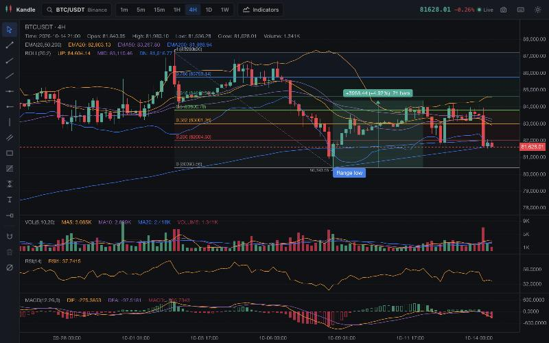

# Kandle

**免费、开源的加密货币、股票和外汇图表工具，并且可以让你的 AI 助手直接操作。**

指标、画线工具、自定义脚本、价格提醒、K 线回放，以及最多四个图表同屏显示。无需注册，没有付费墙，指标数量不限。在浏览器中运行，所有数据都保存在你自己的电脑上。

Claude Code、Codex、Cursor 或 Gemini CLI 可以读取图表、画出支撑位和阻力位、添加指标、编写脚本、设置提醒，你可以在旁边实时看到每一步。

**[在浏览器中打开 Kandle](https://kernel-hunter.github.io/kandle/)** · [连接 AI 助手](#连接-ai-助手) · [编写脚本](#脚本)

[English](README.md) · [简体中文](README.zh-CN.md)



## 连接 AI 助手

Claude Code 只需一行：

```sh
claude mcp add kandle -- npx -y --package=https://github.com/Kernel-Hunter/kandle/releases/download/v0.2.1/kandle-mcp-0.2.1.tgz kandle-mcp
```

然后打开 Kandle，点击顶部的 **Agent**，粘贴助手给你的配对码（它会调用 `get_bridge_status`，配对码也保存在 `~/.kandle/bridge-token`），再打开 **Agent bridge**。之后可以直接说：“在 BTC 上标出最近的波段高点和低点，并在两者之间画斐波那契回撤。”

Codex（`~/.codex/config.toml`）：

```toml
[mcp_servers.kandle]
command = "npx"
args = ["-y", "--package=https://github.com/Kernel-Hunter/kandle/releases/download/v0.2.1/kandle-mcp-0.2.1.tgz", "kandle-mcp"]
```

Cursor（`~/.cursor/mcp.json`）和 Gemini CLI（`~/.gemini/settings.json`）：

```json
{
  "mcpServers": {
    "kandle": {
      "command": "npx",
      "args": ["-y", "--package=https://github.com/Kernel-Hunter/kandle/releases/download/v0.2.1/kandle-mcp-0.2.1.tgz", "kandle-mcp"]
    }
  }
}
```

只需要 Node.js 22.12 或更高版本。使用在线版时，浏览器可能会询问该页面是否可以访问本地网络设备，请允许，这样页面才能连接到 `127.0.0.1` 上的 `kandle-mcp`。

助手可以使用 21 个工具：读取图表状态和 K 线数据、切换品种和周期、添加或删除指标、画线（趋势线、水平线、射线、矩形、斐波那契回撤、文字标注等）、截图、设置提醒、K 线回放、多图布局，运行脚本以及读取策略回测结果。[`skills/kandle/SKILL.md`](skills/kandle/SKILL.md) 提供了支撑阻力、趋势分析、指标共振等分析流程。

安全性：桥接服务只监听 `127.0.0.1`；默认关闭，需要你手动打开；每个连接都必须先发送配对码；只接受来自本机页面和官方在线版的连接，并检查 `Host` 头以防止 DNS 重绑定。完整说明见 [English README](README.md#security-model)。


## 功能

- 来自 Binance、Coinbase、Bybit、OKX 和 Kraken 公开行情接口的实时加密货币 K 线，无需 API key。
- 使用你自己的免费 key，通过 Twelve Data、Alpaca 或 Polygon 查看美股及全球股票、ETF 和外汇。key 只保存在你的浏览器中，只会发送给对应的数据提供商。
- 周期：1m、5m、15m、1H、4H、1D、1W。向左滚动可加载更早的历史数据。
- 34 个内置指标，数量不限，所有参数都可以修改：MA、EMA、布林带、VWAP、Supertrend、MACD、RSI、KDJ、ATR、OBV、DMI/ADX 等。
- 画线工具：趋势线、射线、水平线、平行通道、矩形、斐波那契回撤、价格区间、文字标注，支持磁吸到 K 线价格。
- 价格提醒：价格穿越某个价位、你画的线或指标数值时，通过浏览器通知提醒。
- K 线回放：从历史上任意一根 K 线开始逐根播放。
- 1、2 或 4 个图表同屏，每个图表有自己的品种、周期和指标。
- 深色和浅色主题，键盘快捷键（在应用中按 `?` 查看），图表可导出为 PNG。

## 脚本

Kandle Script 可以编写自己的指标。它兼容大多数图表用户熟悉的脚本语言，很多现有的指标脚本几乎不用修改就能运行。点击 **Scripts**（或按 `Alt+S`）打开编辑器，按 `Ctrl+Enter`（Mac 上是 `Cmd+Enter`）添加到图表。

```
//@version=5
indicator("EMA cross", overlay = true)
fast = ta.ema(close, input.int(9, "Fast"))
slow = ta.ema(close, input.int(21, "Slow"))
plot(fast, "Fast", color.orange, 2)
plot(slow, "Slow", color.blue, 2)
plotshape(ta.crossover(fast, slow), "Up", shape.triangleup, location.belowbar, color.green)
```

### 策略回测

把 `indicator()` 换成 `strategy()`，脚本就会在图表已加载的 K 线上回测：用 `strategy.entry`、`strategy.exit`（止损、止盈、移动止损）、`strategy.close` 下单，成交以箭头标在 K 线图上，图表下方的 **Strategy** 标签页显示净利润、胜率、盈亏比、最大回撤、夏普比率、资金曲线和逐笔交易列表。订单在下一根 K 线成交：市价单按开盘价，限价单和止损单在价格触及时成交；同一根 K 线同时触及止损和止盈时，假设价格先走向离开盘价较近的高点或低点。AI 助手通过 `run_script` 和 `get_backtest` 也能拿到同样的结果。完整说明见 [English README](README.md#strategies-and-backtesting)。

支持的语法和函数列表见 [English README](README.md#what-is-supported)。暂不支持 `request.*`。

## 本地运行

需要 Node.js 22.12 或更高版本，以及 pnpm。

```sh
pnpm install
pnpm dev
```

## 许可证

MIT，见 [LICENSE](LICENSE)。图表使用 [KLineChart](https://github.com/klinecharts/KLineChart)（Apache-2.0），脚本编辑器使用 [CodeMirror](https://codemirror.net)（MIT）。
